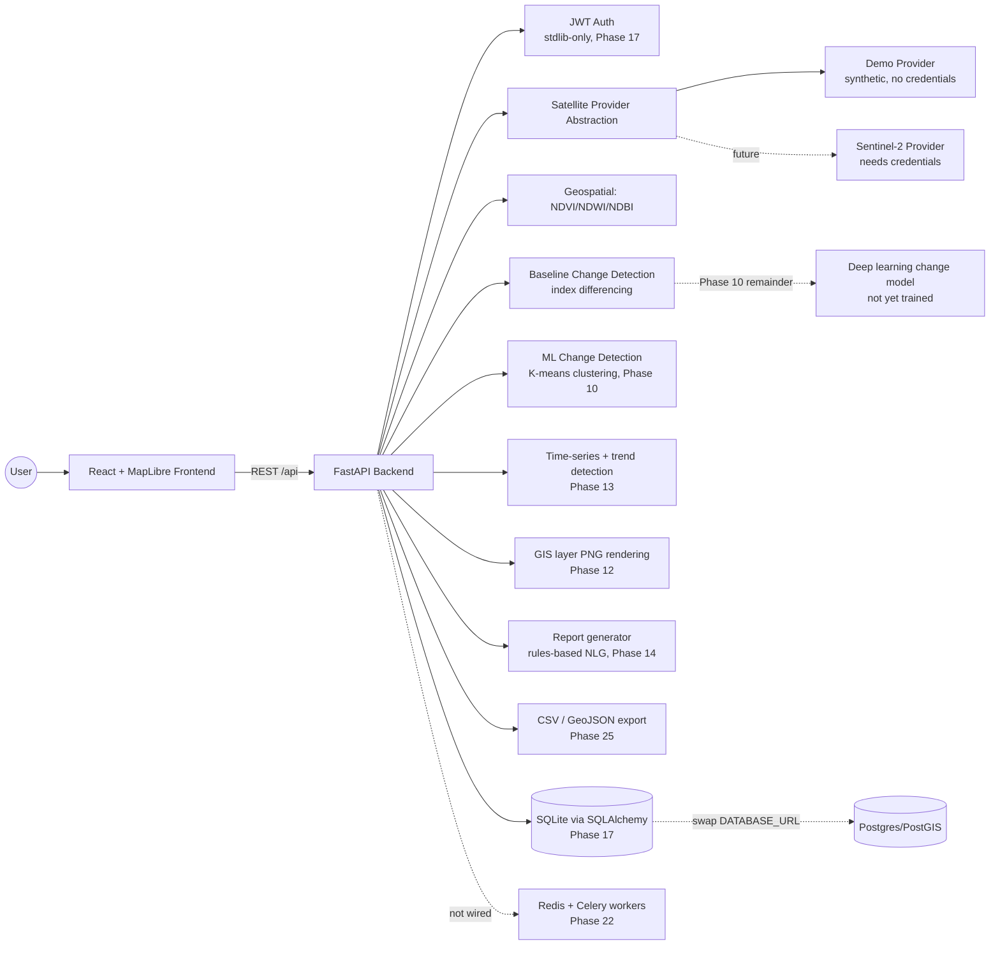
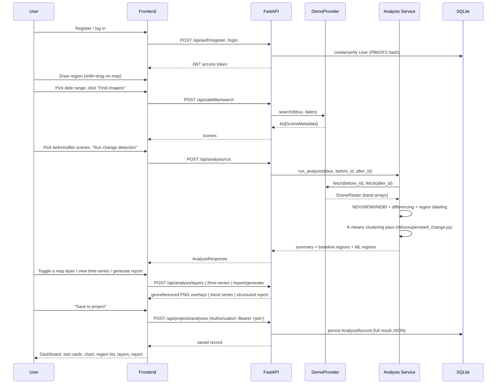

# Architecture

## System overview



**What's real today**: Frontend → Backend → Demo Provider → Indices →
baseline + unsupervised-ML change detection → GIS layer overlays →
time-series → report generation → JWT-authenticated project/analysis
persistence (SQLite) → CSV/GeoJSON export. All synchronous (no job queue
yet), all backed by real computation — nothing in this list returns
hardcoded numbers.

**What's scaffolded, not wired in**: the *trained* deep-learning change
model (Phase 10's supervised half — `app/ml/change_model.py` deliberately
raises `NotImplementedError` rather than fake it), Redis/Celery async jobs,
PDF export, the AI chat assistant, and the predictive-analysis module. Each
has a clear extension point (see "Extension points" below).

## Request flow (current)



## Folder structure

```
earthvision-ai/
├── backend/
│   └── app/
│       ├── api/            # FastAPI routers: routes, auth_routes, project_routes, extras_routes
│       ├── analysis/        # baseline change detection + time_series.py (Phase 13)
│       ├── geospatial/      # NDVI/NDWI/NDBI, area math, rendering.py (PNG layer export, Phase 12)
│       ├── ml/              # unsupervised_change.py (Phase 10, real) + change_model.py (deep model, stub)
│       ├── satellite/       # provider abstraction + demo provider + registry
│       ├── schemas/         # Pydantic request/response models (analysis, auth, project, extras)
│       ├── services/        # orchestration: analysis_service.py, layers_service.py
│       ├── core/            # config.py (settings), security.py (JWT+PBKDF2, stdlib-only), deps.py (auth dependency)
│       ├── models/          # SQLAlchemy models: user.py, project.py, analysis.py
│       ├── database/        # session.py (engine/session/init_db)
│       ├── reports/         # report_generator.py (Phase 14), export.py (Phase 25 — CSV/GeoJSON)
│       ├── workers/         # (Phase 22: Celery tasks — not yet implemented)
│       └── main.py
├── frontend/
│   └── src/
│       ├── components/      # MapSelector, AnalysisPanel, ResultsDashboard,
│       │                    # LayerControls, TimeSeriesPanel, ReportPanel,
│       │                    # AuthWidget, ExportAndSave
│       ├── lib/api.ts        # typed backend client (all endpoints)
│       └── store/            # Zustand app state (incl. auth token, layers, active layer)
├── docs/                    # this documentation
├── docker/                  # (compose files reference backend/frontend Dockerfiles directly)
├── data/                    # local dev data (gitignored, not committed)
└── docker-compose.yml
```

## Extension points (how each stubbed piece plugs in without a rewrite)

- **Real satellite provider**: implement `SatelliteProvider` (see
  `app/satellite/base.py`), register it in `app/satellite/registry.py`. No
  other file changes needed — `analysis_service.py` only calls the interface.
- **Trained deep-learning change model**: implement
  `SiameseChangeDetector.predict()` in `app/ml/change_model.py` once trained
  on LEVIR-CD/OSCD (see `docs/datasets.md`); call it from
  `analysis_service.run_analysis` alongside the existing baseline and
  K-means passes, surfaced as a third `deep_ml_regions` field. The unsupervised
  K-means pass (`app/ml/unsupervised_change.py`) already demonstrates the
  pattern of running a second detector and reporting agreement (IoU) against
  the baseline — the trained model would slot in the same way.
- **PostgreSQL/PostGIS**: change `DATABASE_URL` in `.env` (see
  `.env.example`) from the SQLite default to a `postgresql+psycopg2://...`
  URL and install `psycopg2-binary` — the SQLAlchemy models in `app/models/`
  don't change. Add GeoAlchemy2 geometry columns for true spatial indexing
  when moving off SQLite.
- **Async jobs**: `app/workers/` is where Celery tasks
  (`download_imagery`, `preprocess`, `run_analysis`) would live; the
  `docker-compose.yml` has commented-out `redis`/`worker` services ready to
  uncomment once implemented. `/api/analysis/run` would become a
  "queued → downloading → preprocessing → analyzing → completed" polling
  endpoint instead of a synchronous call.
- **PDF export / AI chat / predictive analysis**: not yet started. PDF export
  would extend `app/reports/export.py` (which already has the CSV/GeoJSON
  pattern to follow); the chat assistant and predictive module are natural
  next additions once an LLM API key or a trained forecasting model is
  available — the structured `AnalyzeResponse` and `AnalysisRecord` data
  already give them something real to ground answers in.
